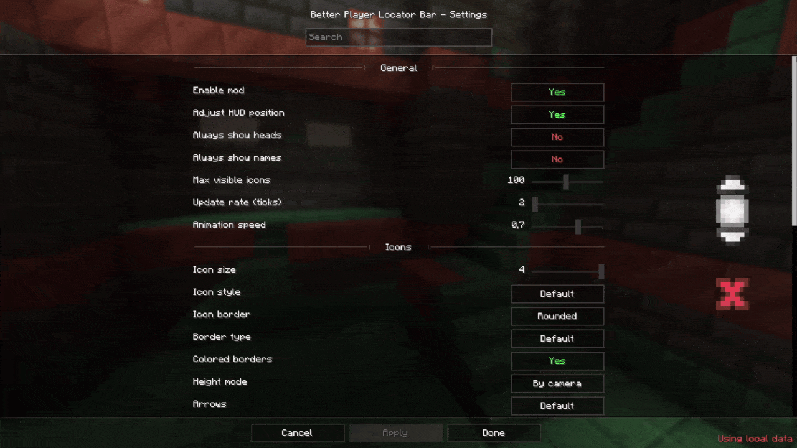
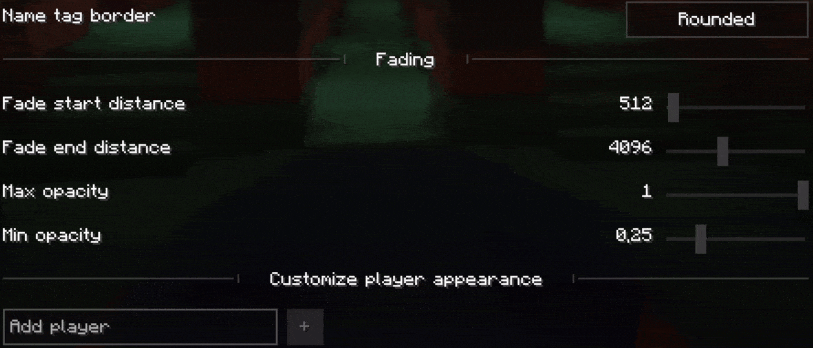

<h1 align="center">Better Player Locator Bar</h1>

<p align="center">
    <a href="https://github.com/bichal/BetterPlayerLocatorBar/releases/tag/v1.1.1"></a>
    <a href="LICENSE"></a>
    <a href="https://modrinth.com/mod/bplb"></a>
    <a href="https://www.curseforge.com/minecraft/mc-mods/better-player-locator-bar"></a>
    <a href="https://github.com/bichal/BetterPlayerLocatorBar/issues"></a>
</p>

Better Player Locator Bar is a Fabric and NeoForge mod. It shows players in a HUD bar above the XP bar. You can customize icons, borders, fades, and more.

## 🎯 Features

- HUD bar with icons representing nearby players and death markers
- Customizable icon style: `default`, `minimal`, `mojang`, `bowtie (shift + click)`
- Icon border styles: `rounded` or `squared`
- Option to show player names and heads
- Vertical arrows when height difference is significant by player camera or position
- Distance-based fading (configurable start, end, alpha min/max)
- Smooth interpolation using easing
- Asset detection: scans included textures in `sprites/hud/`
- Client/server sync via handshake and position payloads; fallback to local mode
- Config UI (`F8` in game or use `ModMenu`), preview, per-player overrides (color, icon, border...)
- Death markers persistence and cleanup

## 📸 Gallery
<p align="center">
    <blockquote>A preview of how you would see other players with the mod</blockquote>
    
    <blockquote>A preview of a player on the HUD</blockquote>
    
    <blockquote>A preview of two players on the HUD</blockquote>
    
    <blockquote>This would be a preview of the settings screen so you can customize it as much as you want</blockquote>
    
    <blockquote>Now you can customize your friends icons</blockquote>
    
</p>

## Requirements

| Minecraft | Fabric | NeoForge | Mode |
|---|---|---|---|
| 1.21 - 1.21.1 | Loader ≥ 0.16, Fabric API | 21.1+ | own locator bar |
| 1.21.2 - 1.21.3 | Loader ≥ 0.16, Fabric API | 21.3+ | own locator bar |
| 1.21.4 | Loader ≥ 0.16, Fabric API | 21.4+ | own locator bar |
| 1.21.5 | Loader ≥ 0.16, Fabric API | 21.5+ | own locator bar |
| 1.21.6 - 1.21.7 | Loader ≥ 0.16, Fabric API | not released by NeoForge | vanilla waypoints |
| 1.21.8 | Loader ≥ 0.16, Fabric API | 21.8+ | vanilla waypoints |
| 1.21.9 - 1.21.10 | Loader ≥ 0.16, Fabric API | 21.10+ (1.21.10) | vanilla waypoints |
| 1.21.11 | Loader ≥ 0.16, Fabric API | 21.11+ | vanilla waypoints |
| 26.1 - 26.3 | Loader ≥ 0.19, Fabric API | 26.1.2+, 26.2+, 26.3+ | vanilla waypoints |

Java 21 up to 1.21.11, Java 25 from 26.1. [Mod Menu](https://modrinth.com/mod/modmenu) is optional on Fabric; on NeoForge the settings are in the mod list.

How it works:

- **1.21 to 1.21.5** have no locator bar of their own, so the mod brings one. If the server has the mod (server mode) every player's position comes from the server, however far away. Without it (local mode) only players your game can see (inside render distance) are shown. The settings screen shows which mode you are in.
- **1.21.6 and newer** already have Mojang's locator bar. The mod does not add a second one or its own network traffic: it uses the vanilla waypoints and only draws them with your icons, colours, fading and name plates. The server does not need the mod. If it has it, the server also does less work per player movement for the vanilla waypoints (same result, about a quarter less time in that code with 100 moving players); `-Dbplb.optimizeWaypoints=false` turns that off.

## Installation

1. Install your loader (and Fabric API on Fabric)
2. Put `better-player-locator-bar-<version>+<minecraft>-<loader>.jar` into your `mods/` folder
3. Run Minecraft

<!-- publish:off -->

## Building

Clone [PanzerBuildLogic](https://github.com/PanzerDevOrg/PanzerBuildLogic) next to this repository as `panzer-build-logic`
(Gradle 9.8 on Java 25; the build downloads the Java 21 toolchain it needs for 1.21.x):

```bash
git clone https://github.com/PanzerDevOrg/PanzerBuildLogic.git panzer-build-logic
cd BetterPlayerLocatorBar
./gradlew buildAndCollect                      # every version and loader, jars in build/libs/<version>/
./gradlew :1.21.1:build :1.21.1-fabric:build   # one version: NeoForge is the plain name, Fabric ends in -fabric
./gradlew :1.21.1-fabric:runClient             # dev client (-Pbplb.quickplay=<host> joins a server)
```

The versions, their ranges and the renamed-class replacements are in `mod.stonecutter.properties.toml`.
Loader code is only in `net.bichal.bplb.platform.<loader>`; the rest uses Mojang names and no loader API.
1.21.6, 1.21.7 and 1.21.9 are Fabric only (NeoForge never released them).

<!-- panzer:license -->
## License

| Content | License |
|---|---|
| Source code | [CC BY-NC-SA 4.0](https://creativecommons.org/licenses/by-nc-sa/4.0/), see [`LICENSE-CC`](./LICENSE-CC) |
| Artwork, branding and documentation | [CC BY-NC-SA 4.0](https://creativecommons.org/licenses/by-nc-sa/4.0/), see [`LICENSE-CC`](./LICENSE-CC) |

**Source code:** credit Bichal, no commercial use without permission, and share derivatives under the same license.

**Artwork:** credit Bichal, no commercial use without permission, and share derivatives under the same license.

See [`LICENSE`](./LICENSE) for the full summary.
<!-- /panzer:license -->

<!-- publish:on -->

---

<!-- panzer:footer -->
Code: **CC BY-NC-SA 4.0** · Art: **CC BY-NC-SA 4.0** · Made by **Bichal**
<!-- /panzer:footer -->
