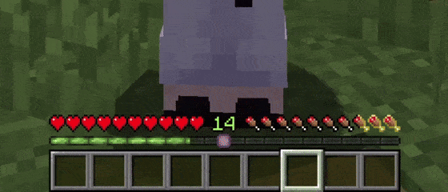
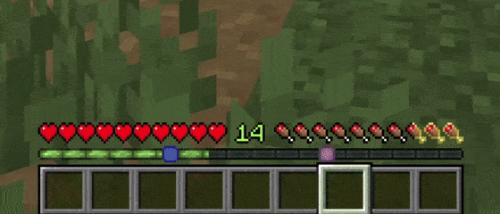

<h1 align="center">Better Player Locator Bar</h1>

<p align="center">
    <a href="https://github.com/bichal/BetterPlayerLocatorBar/releases/tag/v1.1.1"></a>
    <a href="LICENSE"></a>
    <a href="https://modrinth.com/mod/bplb"></a>
    <a href="https://www.curseforge.com/minecraft/mc-mods/better-player-locator-bar"></a>
    <a href="https://github.com/bichal/BetterPlayerLocatorBar/issues"></a>
</p>

Better Player Locator Bar is a Fabric and NeoForge mod. It shows players in a HUD bar above the XP bar. You can customize icons, borders, fades, and more.

## 🎯 Features

- HUD bar with icons representing nearby players and death markers
- Customizable icon style: `default`, `minimal`, `mojang`, `bowtie (shift + click)`
- Icon border styles: `rounded` or `squared`
- Option to show player names and heads
- Vertical arrows when height difference is significant by player camera or position
- Distance-based fading (configurable start, end, alpha min/max)
- Smooth interpolation using easing
- Asset detection: scans included textures in `sprites/hud/`
- Client/server sync via handshake and position payloads; fallback to local mode
- Config UI (`F8` in game or use `ModMenu`), preview, per-player overrides (color, icon, border...)
- Death markers persistence and cleanup

## 📸 Gallery
<p align="center">
    <blockquote>A preview of how you would see other players with the mod</blockquote>
    
    <blockquote>A preview of a player on the HUD</blockquote>
    
    <blockquote>A preview of two players on the HUD</blockquote>
    
    <blockquote>This would be a preview of the settings screen so you can customize it as much as you want</blockquote>
    
    <blockquote>Now you can customize your friends icons</blockquote>
    
</p>

## Requirements

| Minecraft | Fabric | NeoForge |
|---|---|---|
| 1.21 - 1.21.1 | Loader ≥ 0.16, Fabric API | NeoForge 21.1+ |
| 1.21.2 - 1.21.3 | Loader ≥ 0.16, Fabric API | NeoForge 21.3+ |
| 1.21.4 | Loader ≥ 0.16, Fabric API | NeoForge 21.4+ |

Java 21 on every version. [Mod Menu](https://modrinth.com/mod/modmenu) is optional on Fabric; on NeoForge the settings are in the mod list.
How it works:

- **Server has the mod (server mode):** every player's position comes from the server, however far away, for as long as you stay connected.
- **Server without the mod (local mode):** only players your game can see (inside render distance) are shown.

The settings screen shows which mode you are in.

## Installation

1. Install your loader (and Fabric API on Fabric)
2. Put `better-player-locator-bar-<version>+<minecraft>-<loader>.jar` into your `mods/` folder
3. Run Minecraft

## Building

One Gradle project per Minecraft version and loader, built from the same sources with [Stonecutter](https://stonecutter.kikugie.dev/):

```
./gradlew :1.21.1-fabric:build        # one version, one loader
./gradlew build                       # everything
./gradlew :1.21.1-fabric:runClient    # dev client (also :1.21.1-neoforge:runClient)
```

The shared code uses Mojang names and no loader API; each loader only has its entrypoints in
`net.bichal.bplb.platform.<loader>`. Add a version in `settings.gradle.kts` and `versions/<version>-<loader>/gradle.properties`.
## License

The contents of this repository and mod, are licensed under a <a href="LICENSE">Creative Commons Attribution-NonCommercial-ShareAlike 4.0 International License</a>. ([Canonical URL](https://creativecommons.org/licenses/by-nc-sa/4.0/))